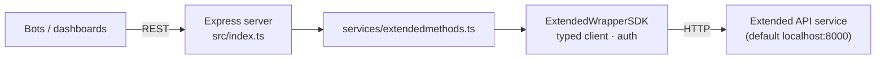

# ProxyExtendedServer

### REST proxy over the Extended perpetuals exchange

  

A small Express + TypeScript service that sits in front of an [Extended](https://extended.exchange) perps API service and exposes it through a typed SDK wrapper (default upstream: `http://localhost:8000`). Other services and trading bots can then read positions, holdings, orders, and funding rates over plain REST.

## Endpoints

| Method | Path | Returns |
|---|---|---|
| `GET` | `/health` | Liveness check |
| `GET` | `/positions` | Open positions for the configured account |
| `GET` | `/holdings` | Balances and collateral |
| `GET` | `/marketOrders/:marketName` | Orders for a market |
| `GET` | `/fundingRates/:marketName/:side` | Funding-rate history for a market and side |

## Architecture



## Getting started

```bash
npm install
# point the wrapper at your Extended API service (see src/ExtendedWrapperSDk/index.ts)
npm run dev            # ts-node-dev with hot reload
npm run build && npm start
```

## Structure

```
src/
├── index.ts                 Express routes
├── services/                Endpoint logic
├── ExtendedWrapperSDk/      Typed wrapper around the Extended API
└── utils/                   Shared types and constants
```
